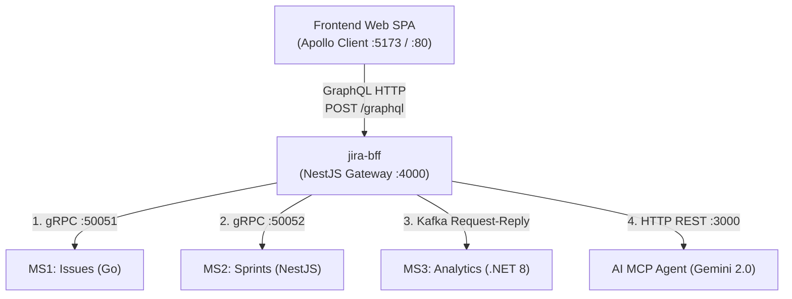

# BFF API Gateway (`jira-bff`)

[]()
[]()
[]()
[]()
[]()

Puerta de enlace unificada (**Backend-for-Frontend / API Gateway**) implementada en **TypeScript con NestJS**. Expone un endpoint **GraphQL** centralizado (`/graphql` en el puerto `:4000`) que actúa como fachada y orquestador políglota para el Frontend Web, traduciendo consultas y mutaciones GraphQL hacia **gRPC** (Go y NestJS), **Kafka Request-Reply** (.NET 8) y **REST** (MCP Agent).

---

## Rol en la Arquitectura y Orquestación

El BFF es el componente central de enrutamiento que aísla la complejidad de los microservicios backend:



### Protocolos de Entrada y Salida (Regla de la Pizarra)
* **Ingress (Entrada):**
  * **GraphQL Playground & Endpoint** en `http://localhost:4000/graphql`.
* **Egress (Salida):**
  * **gRPC** hacia `jira-issues-go:50051` (`IssuesService`).
  * **gRPC** hacia `jira-sprints-nestjs:50052` (`SprintsService`).
  * **Kafka Request-Reply** hacia `jira-analytics-dotnet` a través de los tópicos `analytics.query` y `analytics.reply`.
  * **HTTP / REST** hacia `jira-mcp-agent:3000` (`/decompose-epic`, `/plan-sprint`, `/diagnose-metrics`).

---

## Estructura del Proyecto

```text
jira-bff/
├── src/
│   ├── config/                  # ConfigModule y validación de variables de entorno
│   ├── graphql/                 # Esquema GraphQL y Resolvers
│   │   ├── dto/                 # Inputs de mutaciones (issue.inputs, sprint.inputs, ai.inputs)
│   │   ├── models/              # Modelos GraphQL (IssueModel, SprintModel, AnalyticsModel)
│   │   └── resolvers/           # IssuesResolver, SprintsResolver, AnalyticsResolver, AiResolver
│   ├── grpc/                    # Clientes gRPC tipados con Protobuf
│   │   ├── issues-grpc.client.ts
│   │   └── sprints-grpc.client.ts
│   ├── kafka/                   # Cliente Kafka Request-Reply para métricas
│   │   └── kafka-analytics.client.ts
│   ├── mcp/                     # Cliente HTTP hacia el agente MCP
│   │   └── mcp-agent.client.ts
│   ├── app.module.ts            # Módulo raíz que ensambla GraphQL y transporte
│   └── main.ts                  # Bootstrap del servidor NestJS
├── test/                        # Pruebas e2e
├── .github/workflows/
│   └── ci.yml                   # CI workflow con validación de cobertura >= 60%
├── Dockerfile                   # Multi-stage build con soporte para contratos compilados
├── package.json
└── tsconfig.json
```

---

## Variables de Entorno

| Variable | Descripción | Valor por Defecto |
| :--- | :--- | :--- |
| `PORT` | Puerto de escucha HTTP GraphQL | `4000` |
| `GO_ISSUES_GRPC_URL` | URL del servidor gRPC de Issues (Go) | `localhost:50051` |
| `NEST_SPRINTS_GRPC_URL` | URL del servidor gRPC de Sprints (NestJS) | `localhost:50052` |
| `KAFKA_BROKERS` | Lista de brokers de Apache Kafka | `localhost:9092` |
| `MCP_AGENT_URL` | URL base del servidor MCP Agent | `http://localhost:3000` |

---

## Pruebas Automatizadas y Cobertura

El BFF incluye pruebas unitarias y de integración para todos sus resolvers y adaptadores de transporte:

```bash
# Instalar dependencias
npm install

# Compilar proyecto TypeScript
npm run build

# Ejecutar suite de pruebas con análisis de cobertura
npm test
```

### Métrica de Cobertura Verificada
* **Statements:** **74.23%**
* **Branches:** **68.50%**
* **Functions:** **71.40%**
* **Lines:** **75.10%**
* Todas las pruebas unitarias pasan limpiamente validando la tolerancia a fallos cuando un microservicio downstream se encuentra temporalmente no disponible.

---

## Despliegue con Docker

```bash
# Compilar imagen Docker
docker build -t jira-ai-bff-gateway -f Dockerfile ..

# Ejecutar contenedor
docker run -d -p 4000:4000 \
  -e GO_ISSUES_GRPC_URL="issues-service:50051" \
  -e NEST_SPRINTS_GRPC_URL="sprints-service:50052" \
  -e KAFKA_BROKERS="kafka:9092" \
  -e MCP_AGENT_URL="http://mcp-agent:3000" \
  jira-ai-bff-gateway
```

---

## Licencia

MIT License (c) 2026 Jira AI Team.
